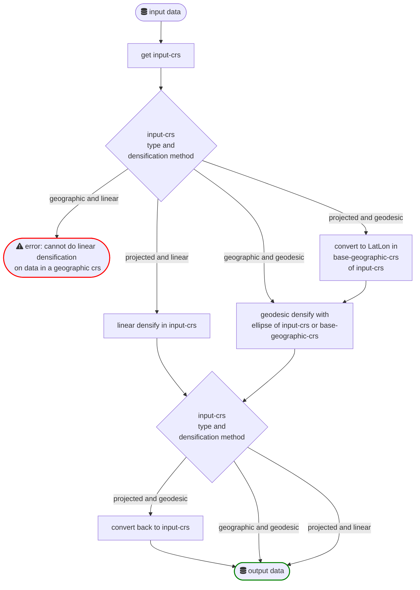

# DOCS

## Library API

geodense can be used as a Python library. The main functions for densifying and checking density are:

### `densify_geojson_object()`

```python
def densify_geojson_object(densify_config: DenseConfig, geojson_obj: GeojsonObject) -> GeojsonObject
```

**Description:** Densifies (multi)polygon and (multi)linestring geometries using geodesic (ellipsoidal great-circle)
calculation. **Mutates the input object in place** and returns the same instance.

**Parameters:**

- `densify_config` (DenseConfig): Configuration object specifying:
  - `max_segment_length` (float): Maximum allowed segment length in meters (default: 50)
  - `src_crs` (CRS | str): Source coordinate reference system (default: "OGC:CRS84")
  - `in_projection` (bool): If True, uses linear densification in source projection; if False (default), uses geodesic
    densification
- `geojson_obj` (GeojsonObject): A GeoJSON Feature, FeatureCollection, Geometry, or GeometryCollection object

**Returns:** The same GeoJSON object, densified with added vertices

**Example:**

```python
from geodense.lib import densify_geojson_object
from geodense.models import DenseConfig
from pyproj import CRS
import copy

config = DenseConfig(
    max_segment_length=100,
    src_crs=CRS.from_epsg(4326),  # WGS84
    in_projection=False,  # Use geodesic
)

geojson_data = {"type": "Feature", "geometry": {"type": "LineString", "coordinates": [[0, 0], [1, 1]]}}
original = copy.deepcopy(geojson_data)
densified = densify_geojson_object(config, geojson_data)
```

### `check_density_geojson_object()`

```python
def check_density_geojson_object(densify_config: DenseConfig, geojson_obj: GeojsonObject) -> CrsFeatureCollection
```

**Description:** Checks if geometries in a GeoJSON object comply with a maximum segment length constraint. Returns a
FeatureCollection report with all line segments that exceed the threshold.

**Parameters:**

- `densify_config` (DenseConfig): Configuration object (same as densify)
- `geojson_obj` (GeojsonObject): Input GeoJSON object

**Returns:** A GeoJSON FeatureCollection where each Feature represents a line segment exceeding `max_segment_length`.
Each Feature has a `segment_length` property (geodesic distance in meters).

### `densify_file()` and `check_density_file()`

For working with GeoJSON files, use the convenience functions in the library. Both support the same CRS and
densification options.

**Important:** `densify_geojson_object()` **mutates its input in place**. Copy the object first if you need the
original:

```python
import copy

original = copy.deepcopy(geojson_data)
densified = densify_geojson_object(config, geojson_data)
```

______________________________________________________________________

## Densify command

See the following flowchart for a highlevel schematic overview of the `densify` functionality of `geodense`:



**Flowchart Legend:**

- **Input CRS**: The coordinate reference system of your data
- **Geographic CRS**: Latitude/longitude based (e.g., EPSG:4326, WGS84)
- **Projected CRS**: Projected onto a plane (e.g., EPSG:28992, Dutch RD)
- **Base-geographic-crs**: The underlying geographic CRS of a projected CRS (for RD: ETRS89)
- **Linear densification**: Straight lines in source projection (fast, less accurate)
- **Geodesic densification**: Great-circle arcs on the ellipsoid (more accurate)

## NSGI transformations

For correct Dutch (NSGI) coordinate transformations, geodense must run on the NSGI build of `pyproj`. This build ships a
modified `proj.db` containing the `NSGI` authority, plus the bundled grids. With stock `pyproj` from PyPI you get
generic PROJ behaviour, which is less accurate for the Netherlands.

The NSGI `pyproj` wheels are pinned in `pyproject.toml` via `[tool.uv.sources]` and are available from the GitHub
releases page of the
[GeodetischeInfrastructuur/transformations](https://github.com/GeodetischeInfrastructuur/transformations/releases) repo
(CPython 3.12–3.15 on Linux x86_64). Use `uv` so this pin is honoured.

______________________________________________________________________

## Supported CRS Formats

geodense accepts CRS specifications in several formats via the `--src-crs` option or the `src_crs` parameter:

**Formats:**

- **EPSG codes:** `EPSG:4326`, `EPSG:28992`, `EPSG:4258`
- **OGC codes:** `OGC:CRS84`, `OGC:CRS84h` (3D)
- **NSGI codes:** `NSGI:<code>` (NSGI pyproj build only)

**Common examples for Dutch datasets:**

- `EPSG:4326` — WGS 84 (geographic)
- `EPSG:4258` — ETRS89 (geographic, European)
- `EPSG:28992` — RD / Dutch grid (projected)
- `EPSG:7415` — RD + NAP height (3D compound)
- `OGC:CRS84` — WGS 84 geographic
- `OGC:CRS84h` — WGS 84 with height (3D)

**CRS Type Behavior:**

- **Geographic CRS**: Geodesic densification is applied (default). Linear densification raises an error.
- **Projected CRS**: Both linear and geodesic modes supported. Geodesic converts to base geographic CRS, densifies,
  converts back.
- **Compound/3D CRS**: Both types supported. Height values are linearly interpolated.

**Auto-detection:** If no `--src-crs` is provided, geodense reads the CRS from the GeoJSON file's `crs` object or
defaults to `OGC:CRS84`.

______________________________________________________________________

## Check-Density Command

The `check-density` subcommand validates whether all line segments comply with a maximum segment length constraint.

**Usage:**

```bash
geodense check-density <input-file> --max-segment-length <meters> [--src-crs EPSG:code]
```

**Output:**

- **Exit code 0** (success): All line segments ≤ max-segment-length
- **Exit code 1** (failure): Some segments exceed the threshold; a report file is written

**Report file format:** When segments exceed the limit, a GeoJSON FeatureCollection is written (default:
`density-report.json`):

```json
{
  "type": "FeatureCollection",
  "features": [
    {
      "type": "Feature",
      "geometry": {"type": "LineString", "coordinates": [[5.0, 52.0], [5.1, 52.1]]},
      "properties": {"segment_length": 12345.67}
    }
  ]
}
```

- `segment_length`: Geodesic distance (in meters) when `--in-projection` is false; distance in source projection units
  when true.

**Examples:**

```bash
# Check all segments ≤ 100m (geodesic)
geodense check-density roads.geojson --max-segment-length 100

# Write report to custom file
geodense check-density roads.geojson --max-segment-length 100 --density-check-report violations.json

# Check in RD projection using linear distance
geodense check-density roads.geojson --max-segment-length 100 --src-crs EPSG:28992 --in-projection
```

______________________________________________________________________

## Library usage note

`densify_geojson_object()` and `traverse_geojson_geometries()` **mutate the input in place**. Copy first if retaining
the original is needed.
