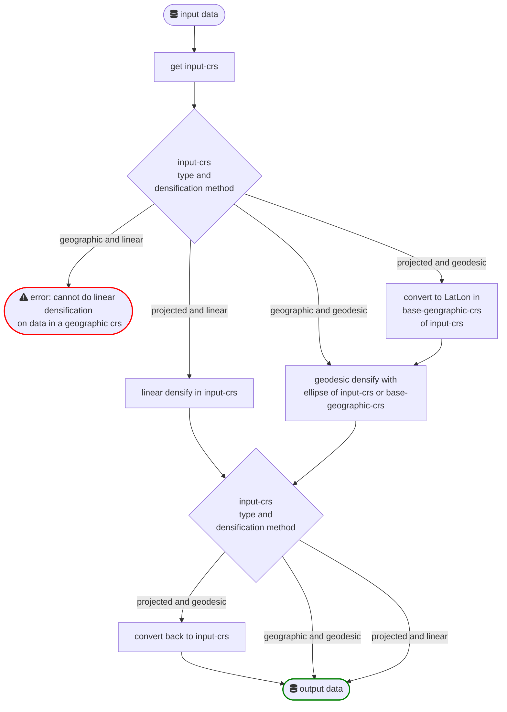

# DOCS

## Densify command

See the following flowchart for a highlevel schematic overview of the `densify` functionality of `geodense`:

## NSGI transformations

For correct Dutch (NSGI) coordinate transformations, geodense must run on the NSGI build of `pyproj`. This build ships a
modified `proj.db` containing the `NSGI` authority, plus the bundled grids. With stock `pyproj` from PyPI you get
generic PROJ behaviour, which is less accurate for the Netherlands.

The NSGI `pyproj` wheel is pinned in `pyproject.toml` via `[tool.uv.sources]` and is only available from the GitHub
releases page of the
[GeodetischeInfrastructuur/transformations](https://github.com/GeodetischeInfrastructuur/transformations/releases) repo
(`cp312` / `linux_x86_64` only). Use `uv` so this pin is honoured.

## Library usage note

`densify_geojson_object` (and `traverse_geojson_geometries`) mutate the input in place and return it; copy the object
first (e.g. `obj.model_copy(deep=True)`) if you need to retain the original.
